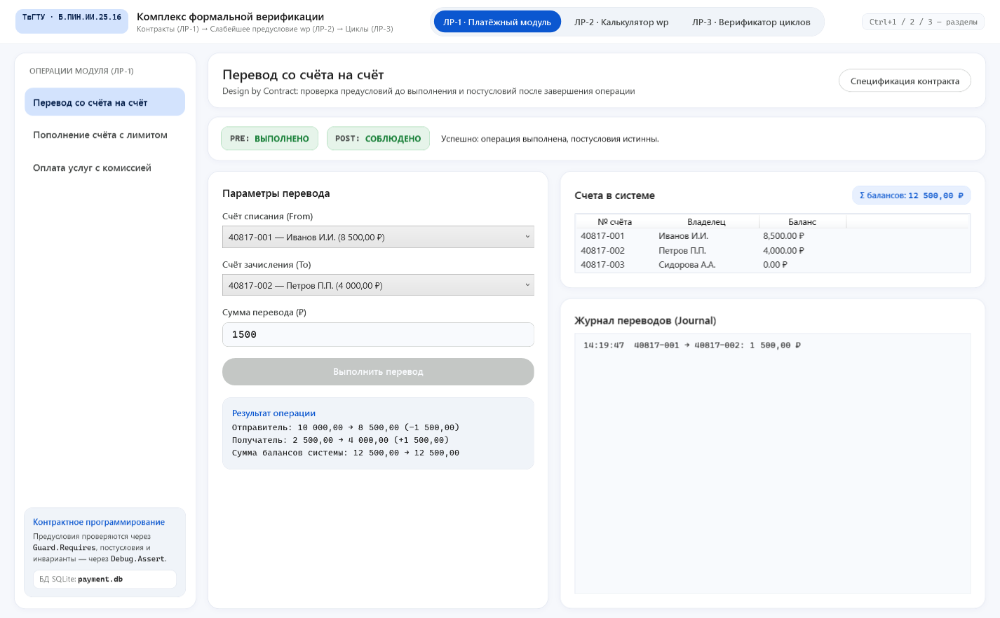
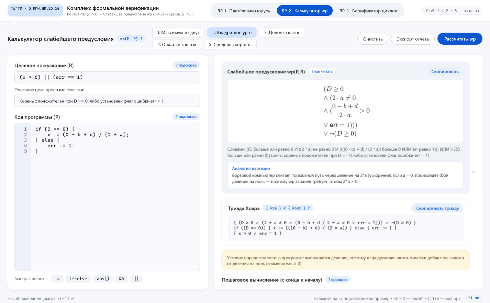
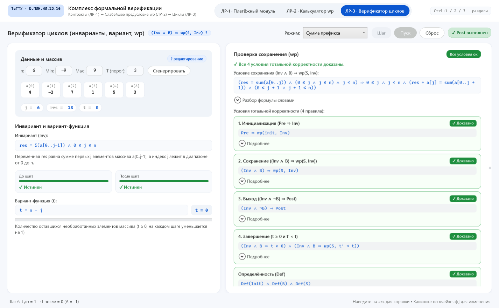
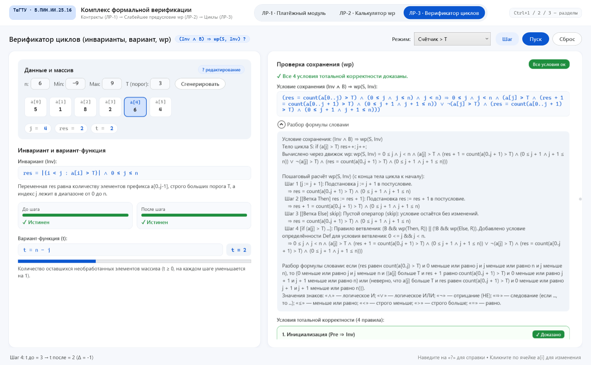
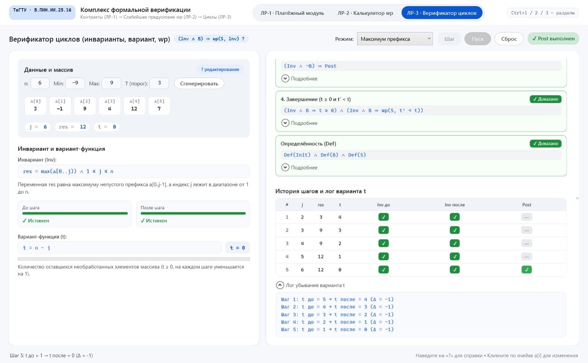

# Интерактивный проверщик корректности циклов (инварианты, вариант-функции, wp)

Учебный научно-практический проект по дисциплине «Теоретическая информатика»  
**ТвГТУ, группа Б.ПИН.ИИ.25.16**

| Параметр | Спецификация |
| :--- | :--- |
| **Версия проекта** | `v3.0.0` (Единый комплекс: ЛР-1 + ЛР-2 + ЛР-3) |
| **Язык программирования** | C# 12.0 (Nullable Reference Types, Records, Pattern Matching) |
| **Целевая платформа** | .NET 8.0 LTS (`net8.0`, `net8.0-windows`) |
| **Графическая подсистема** | Windows Presentation Foundation (WPF), `WpfMath` 2.1.0 |
| **Модули и движки** | `PaymentApp.Domain` + SQLite (ЛР-1), `WpCalculatorEngine` (ЛР-2), `LoopVerifier` и `LoopRunner` (ЛР-3) |
| **Фреймворк тестирования** | xUnit 2.5.3, `Microsoft.NET.Test.Sdk` 17.8.0, `coverlet.collector` 6.0.0 |
| **Архитектурный шаблон** | MVVM (Model-View-ViewModel), логика Хоара, преобразователь предикатов Дейкстры (`wp`) |

---

## Введение и сквозной сюжет

Программный комплекс представляет собой десктопное WPF-приложение для **трёхуровневой формальной верификации банковского платёжного ядра**, объединяющее все три лабораторные работы в единую сюжетную линию:

1. **ЛР-1 · Платёжный модуль (контракты в рантайме и SQLite):** выполнение клиентских банковских операций (перевод со счёта на счёт с инвариантом суммы балансов, пополнение с дневным лимитом, оплата услуг с комиссией) под контролем `Guard.Requires` / `Debug.Assert` с сохранением всех транзакций в `payment.db`.
2. **ЛР-2 · Калькулятор слабейшего предусловия (`wp`, статическая верификация):** математический вывод слабейшего предусловия `wp(P, R)` для алгоритмов банковских операций из ЛР-1 (перевод с инвариантом баланса, выбор лимита карты, оплата с кэшбэком, рассрочка платежа с `Def`, расчёт среднего чека дня перед аудитом транзакций).
3. **ЛР-3 · Верификатор циклов (аудит транзакций и финмониторинг):** интерактивная проверка тотальной корректности циклов вида `init; while (B) { S }` по массиву транзакций банковского дня `a[0..n-1]` — с возможностью напрямую загружать реальные суммы транзакций из базы `payment.db` (ЛР-1) и автоматическим переиспользованием движка `wp` из ЛР-2.

**Ключевые особенности проекта:**
* **Живой мост данных ЛР-1 → ЛР-3 (`payment.db`):** единый экземпляр `PersistentBank` разделяется между модулями; транзакции, проведённые в ЛР-1, можно в один клик загрузить в массив `a[0..n-1]` в ЛР-3 для пошагового аудита транзакций.
* **Панель данных и три обязательных режима:** генератор банковских сумм и табличный редактор журнала `a[0..n-1]` (`n`, диапазон значений в ₽, порог контроля `T`), режимы `PrefixSum` (оборот за день), `Count > T` (финмониторинг крупных операций) и `PrefixMax` (пиковый платёж смены) с подсветкой текущего индекса `j`.
* **Пошаговое исполнение и контракты (`LoopRunner`):** управление кнопками «Шаг», «Пуск» и «Сброс», встроенные проверки `Debug.Assert` на истинность инварианта до и после шага, контроль `t ≥ 0` и `t' < t`, а также пошаговый журнал убывания вариант-функции.
* **Переиспользование движка `wp` из ЛР-2 (`WpCalculatorEngine`):** расширение AST узлами доступа к массиву `a[j]`, `max(...)`, `sqrt(...)`, префиксными агрегатами и импликацией; автоматический учёт условий определённости `Def` (деление на ноль, корень, границы массива `0 ≤ idx < n`).
* **Формальная верификация и разбор на русском (`LoopVerifier`):** автоматическая проверка всех четырёх условий тотальной корректности (инициализация, сохранение, выход, завершение) и определённости `Def`, пошаговая трассировка `wp(S, Inv)` и расшифровка логических знаков словами через `Humanizer`.

---

## Состав группы

| № | Участник | Роль |
| :---: | :--- | :--- |
| 1 | **Груздев Андрей** | Backend-разработчик (Роль 2) |
| 2 | **Ясенков Никита** | Аналитик |
| 3 | **Иришин Тимофей** | Тестировщик (QA-инженер) |
| 4 | **Воронова Анфиса** | Backend-разработчик |
| 5 | **Кукушкин Андрей** | Frontend-разработчик |
| 6 | **Пестов Михаил** | Frontend-разработчик |

---

## Краткая суть режимов модуля (аудит транзакций и итоги банковского дня `a[0..n-1]`)

| Режим | Инициализация (`init`) и тело (`S`) | Инвариант (`Inv`) и постусловие (`Post`) | Вариант (`t`) и банковский смысл |
| :--- | :--- | :--- | :--- |
| **1. Оборот за день (`PrefixSum`)** | `res := 0; j := 0;`<br>`while (j < n)`<br>`  res += a[j]; j++;` | `Inv:` $res = \sum_{i=0}^{j-1} a[i] \land 0 \le j \le n$<br>`Post:` $res = \sum_{i=0}^{n-1} a[i]$ | `t = n - j` (при `Pre: n ≥ 0`)<br>Сверка оборота: накопленная сумма сходится с первыми `j` транзакциями журнала без потерь |
| **2. Финмониторинг > T (`Count > T`)** | `res := 0; j := 0;`<br>`while (j < n)`<br>`  if (a[j] > T) res++;`<br>`  j++;` | `Inv:` $res = \lvert\{i < j : a[i] > T\}\rvert \land 0 \le j \le n$<br>`Post:` $res = \lvert\{i < n : a[i] > T\}\rvert$ | `t = n - j` (при `Pre: n ≥ 0`)<br>Антифрод-контроль: точный подсчёт крупных операций выше порога `T` (по умолчанию `5000 ₽` — лимит из ЛР-1) |
| **3. Пиковый платёж (`PrefixMax`)** | `res := a[0]; j := 1;`<br>`while (j < n)`<br>`  res = max(res, a[j]);`<br>`  j++;` | `Inv:` $res = \max(a[0..j)) \land 1 \le j \le n$<br>`Post:` $res = \max(a[0..n))$ | `t = n - j` (при `Pre: n ≥ 1`)<br>Контроль пикового риска: поиск крупнейшего платежа по непустой выписке (`Pre: n ≥ 1` гарантирует `Def(a[0])`) |

> **Пояснение:** вычисление `wp(S, Inv)` для тела цикла выполняется строго с конца тела к началу с автоматическим добавлением условий определённости `Def(a[j])`: $0 \le j < n$.

---

## Скриншоты интерфейса

Приложение объединяет все три лабораторные работы в единой оболочке с последовательным переключением вкладок **«ЛР-1 · Платёжный модуль» → «ЛР-2 · Калькулятор wp» → «ЛР-3 · Верификатор циклов»** (`Ctrl+1 / 2 / 3`).

### 1. ЛР-1 · Платёжный модуль (контракты `Pre`/`Post` и SQLite)
Выполнение банковских операций (перевод, пополнение с лимитом, оплата услуг с комиссией) с живым монитором предусловий/постусловий, проверкой инварианта суммы балансов и журналом транзакций:



### 2. ЛР-2 · Калькулятор слабейшего предусловия (`wp`)
Символьный расчёт `wp(P, R)` с визуализацией LaTeX-формул (`WpfMath`), триадой Хоара, автоматическим условием определённости (защита от деления на ноль) и пошаговым обратным ходом:



### 3. ЛР-3 · Режим «Сумма префикса» (`PrefixSum`)
Пошаговое выполнение, зелёные индикаторы инварианта до/после шага, индикатор `Post выполнен` и блок формальной верификации `(Inv ∧ B) ⇒ wp(S, Inv)` с четырьмя условиями тотальной корректности и `Def`:



### 4. ЛР-3 · Режим «Счётчик > T» (`Count > T`)
Подсветка текущего индекса `j`, прогресс-бар убывания вариант-функции `t`, оценка условия ветвления `if (a[j] > T)` и раскрытый пошаговый разбор формулы на русском языке:



### 5. ЛР-3 · Режим «Максимум префикса» (`PrefixMax`)
Инициализация с `j = 1` и `res = a[0]`, полная таблица истории шагов и журнал строгого убывания вариант-функции `t`:



### 6. Модульные тесты и покрытие кода (`xUnit` + `Coverlet`)
Результаты прогона тестов `WpEngine.Tests` и отчёт о покрытии сборки `WpEngine.Core` (**92,4 %** по строкам, **83,5 %** по ветвлениям):


---

## Математическое пояснение

Тотальная корректность цикла `init; while (B) { S }` относительно предусловия `Pre` и постусловия `Post` подтверждается четырьмя условиями и проверкой определённости `Def`:

```text
1. Инициализация:   Pre ⇒ Inv                   (через wp: Pre ⇒ wp(init, Inv))
2. Сохранение:      (Inv ∧ B) ⇒ wp(S, Inv)
3. Выход:           (Inv ∧ ¬B) ⇒ Post
4. Завершение:      (Inv ∧ B ⇒ t ≥ 0)  и  (Inv ∧ B ⇒ wp(S, t' < t))
5. Определённость:  Def(Init) ∧ Def(B) ∧ Def(S)
```

### Сводка доказательств по режимам

#### 1. `PrefixSum` (`Pre: n ≥ 0`, `t = n - j`)
* **Инициализация:** при `res := 0; j := 0` сумма пустого префикса равна `0`, и `0 ≤ 0 ≤ n` следует из `n ≥ 0`.
* **Сохранение:** `wp(S, Inv) = (0 ≤ j < n) ∧ (res + a[j] = sum(a[0..j+1)) ∧ 0 ≤ j + 1 ≤ n)` истинно при `Inv ∧ (j < n)`.
* **Выход:** из `j ≤ n` и `¬(j < n)` следует `j = n`, откуда `res = sum(a[0..n))`.
* **Завершение:** при `j < n` имеем `t = n - j ≥ 1 ≥ 0`, а после `j := j + 1` получаем `t' = t - 1 < t`.

#### 2. `Count > T` (`Pre: n ≥ 0`, `t = n - j`)
* **Инициализация:** при `res := 0; j := 0` в пустом префиксе ровно `0` элементов больше `T`, `0 ≤ 0 ≤ n` следует из `n ≥ 0`.
* **Сохранение:** правило ветвления в `wp(S, Inv)` проверяет `0 ≤ j < n` и обе ветки: при `a[j] > T` счётчик увеличивается на `1`, иначе сохраняет прежнее значение; границы `0 ≤ j + 1 ≤ n` выполняются.
* **Выход:** из `j ≤ n` и `j ≥ n` следует `j = n`, откуда `res = |{i < n : a[i] > T}|`.
* **Завершение:** `t = n - j ≥ 1 ≥ 0` и `t' = t - 1 < t` на каждой итерации.

#### 3. `PrefixMax` (`Pre: n ≥ 1`, `t = n - j`)
* **Инициализация:** `Pre` (`n ≥ 1`) гарантирует `0 < n` (безопасный доступ к `a[0]`), после `res := a[0]; j := 1` получаем `res = max(a[0..1))` и `1 ≤ 1 ≤ n`.
* **Сохранение:** `wp(S, Inv) = (0 ≤ j < n) ∧ (max(res, a[j]) = max(a[0..j+1)) ∧ 1 ≤ j + 1 ≤ n)` следует из `Inv ∧ (j < n)` (`1 ≤ j < n`).
* **Выход:** из `1 ≤ j ≤ n` и `j ≥ n` следует `j = n`, откуда `res = max(a[0..n))`.
* **Завершение:** `t = n - j ≥ 1 ≥ 0` и `t' = t - 1 < t` при каждом шаге.

---

## Тестирование и покрытие

Тестовый проект `WpEngine.Tests` содержит **142 базовых теста** ядра из ЛР-2 (`CodeParserTests`, `ParserTests`, `LexerTests`, `SubstitutionEngineTests`, `EngineTests`, `HumanizerTests`), а также два набора тестов подсистемы циклов:
* `LoopRunnerTests` (20 тестовых методов) — проверка `PrefixSum`, `Count > T`, `PrefixMax`, граничных массивов (`[]`, `[42]`, `int.MinValue`/`int.MaxValue`), сохранения инварианта на шагах, убывания `t`, изоляции копии массива и исключений.
* `LoopVerifierTests` (13 тестовых методов) — проверка 4 условий корректности и `Def` для всех режимов, точной структуры `wp(S, Inv)`, валидации границ индекса и русского разбора формул.

По отчёту `coverlet.collector` (формат Cobertura, 36 классов, 16 файлов):
* **Покрытие строк (`Line coverage`):** `92.4%` (`1398 / 1512`)
* **Покрытие ветвлений (`Branch coverage`):** `83.5%` (`458 / 548`)
* **Ключевые классы:** `LoopVerifier` — `100%`, `LoopRunner` — `99.3%`, `LoopPresets` — `96.6%`, `WpCalculatorEngine` — `91.8%`

---

## Установка и запуск

### Требования к окружению
* **ОС:** Windows 10 / Windows 11 (x64) — требуется для WPF (`net8.0-windows`).
* **SDK:** [.NET SDK 8.0](https://dotnet.microsoft.com/download/dotnet/8.0) (`8.0.100` или выше).
* **Среда разработки (опционально):** Visual Studio 2022 (v17.8+) с рабочей нагрузкой *«.NET Desktop Development»*, JetBrains Rider или VS Code.
* **NuGet-зависимости** (восстанавливаются автоматически): `WpfMath` (`2.1.0`), `xunit` (`2.5.3`), `Microsoft.NET.Test.Sdk` (`17.8.0`), `coverlet.collector` (`6.0.0`).

### Инструкция по шагам

1. **Клонирование репозитория:**
   ```bash
   git clone <URL_вашего_репозитория>
   cd <папка_репозитория>
   ```

2. **Сборка решения в конфигурации Release:**
   ```bash
   dotnet build WpCalculator.sln -c Release
   ```

3. **Запуск модульных тестов и сбор покрытия:**
   ```bash
   dotnet test WpEngine.Tests/WpEngine.Tests.csproj --logger "console;verbosity=normal" --collect:"XPlat Code Coverage"
   ```

4. **Запуск десктопного WPF-приложения:**
   ```bash
   dotnet run --project WpEngine.UI/WpEngine.UI.csproj
   ```
